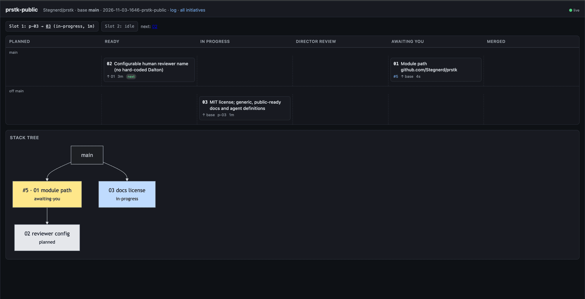
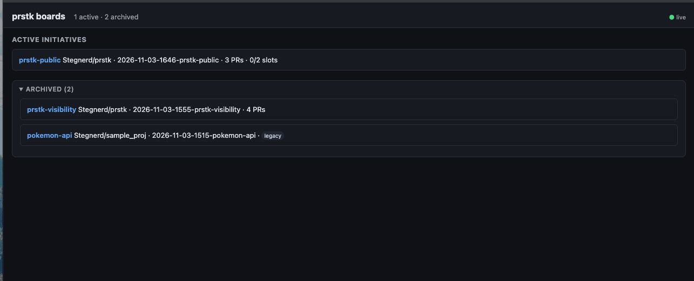
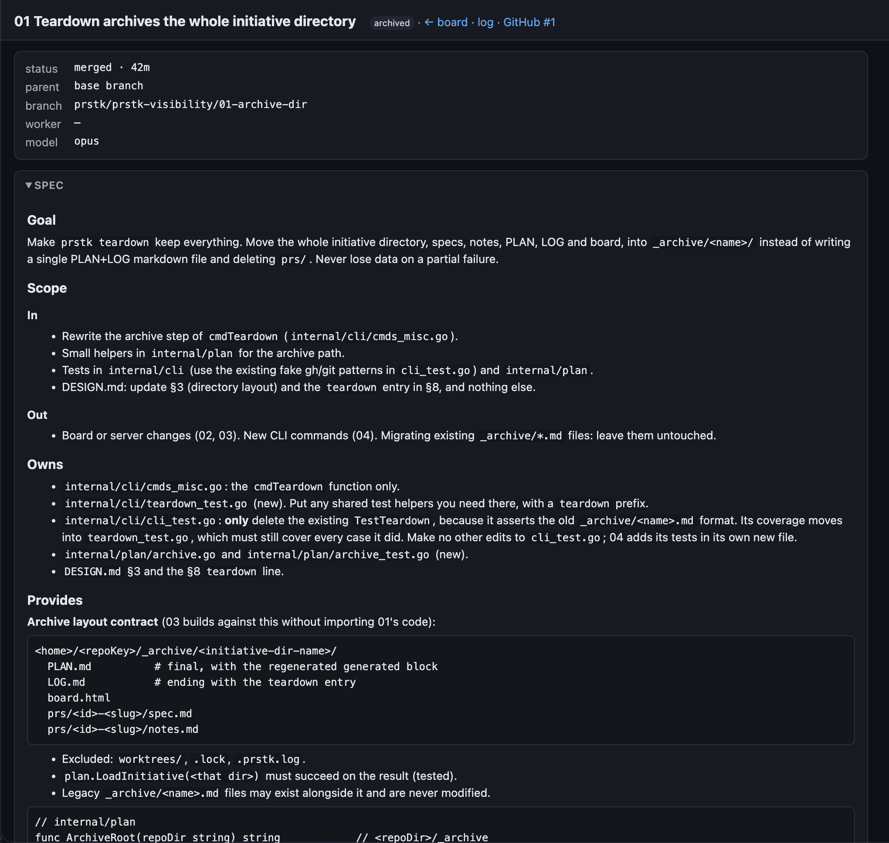
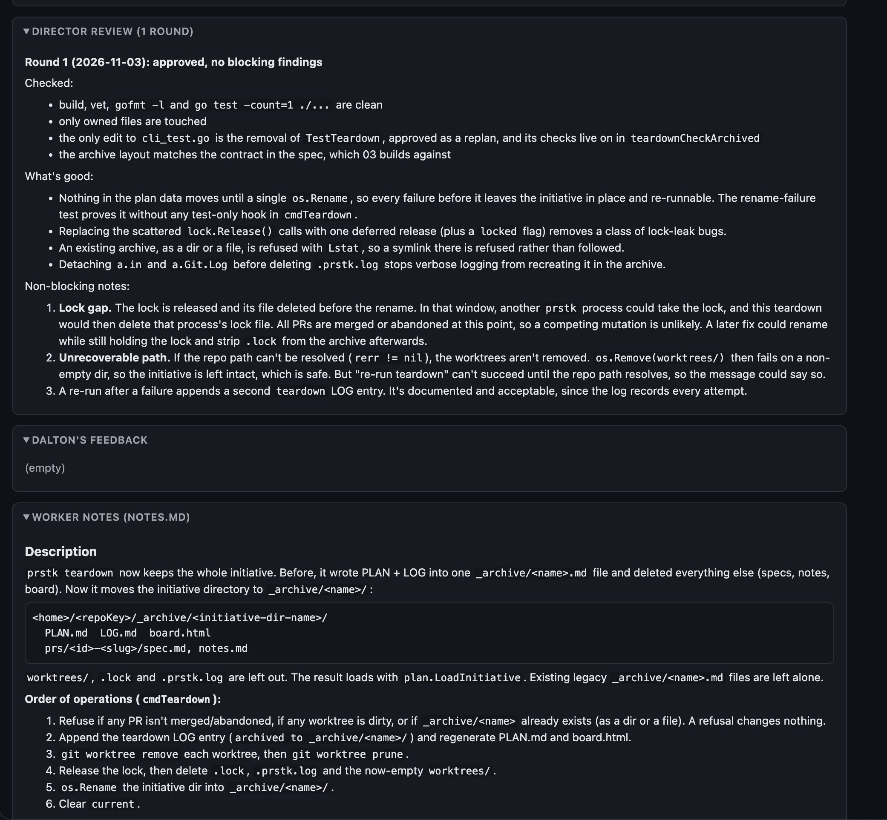
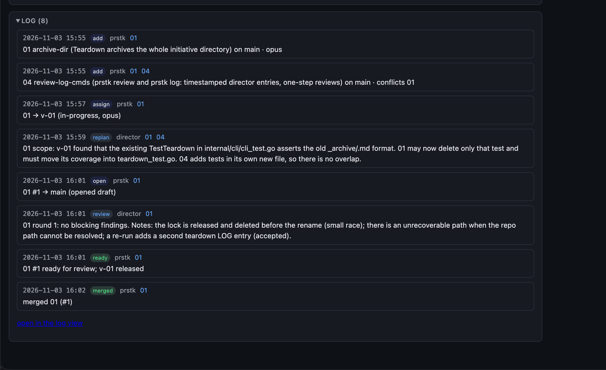

# prstk

Break one task into a **stack of GitHub PRs** and build them in parallel with Claude Code agents.

`prstk` is a Go CLI that does every deterministic mechanic: worktrees, branches, draft PRs, stack navigation, scheduling, retargeting and archiving. A **director** agent does the judgment work: planning, specs and reviews. **Worker** agents write the code, one PR each, in their own git worktrees. You review and merge.



```text
            you (human)
              │  base branch, review feedback, "merged #N"
              ▼
        ┌───────────┐   prstk CLI   ┌──────────────────────────┐
        │ director  │──────────────▶│ ~/.pr-plans/<repo>/<init>│
        │  (opus)   │               │ PLAN.md LOG.md prs/*/    │
        └─────┬─────┘               └──────────────────────────┘
   spawns /   │   \ reviews                    ▲
          ▼   ▼    ▼                           │ notes.md
      ┌────────┐ ┌────────┐                    │
      │worker A│ │worker B│ ── commit/push ────┘
      │ wt/01  │ │ wt/02  │    (one worktree per PR)
      └────────┘ └────────┘
```

The full design is in [DESIGN.md](DESIGN.md). This README covers setup, the day-to-day flow, and what we learned in the first two runs.

---

## Setup (one time)

### 1. Prerequisites

| Need | Check |
|---|---|
| Go 1.27+ | `go version` |
| git | `git --version` |
| GitHub CLI, logged in | `gh auth status` |
| Claude Code with agent teams | `CLAUDE_CODE_EXPERIMENTAL_AGENT_TEAMS=1` |

Turn on agent teams in your **Claude Code user settings**, `~/.claude/settings.json`, under `env`. Claude Code applies it to every session, including the teammates it spawns, without touching your shell profile:

```json
{
  "env": {
    "CLAUDE_CODE_EXPERIMENTAL_AGENT_TEAMS": "1"
  }
}
```

If `settings.json` already exists, add the key to its existing `env` object (or add an `env` object) rather than replacing the file. The value must be the string `"1"`. Restart Claude Code afterwards. `prstk doctor` reads the variable from its own environment, so to check it, run `doctor` from Claude Code's shell, or export the variable in your terminal just for that check.

### 2. Install the CLI and the agents

```sh
go install github.com/Stegnerd/prstk/cmd/prstk@latest   # installs to $(go env GOPATH)/bin/prstk
cd <your-repo>                                          # the repo you want to work on
prstk setup
```

Make sure `$(go env GOPATH)/bin` is on your PATH.

`prstk setup` needs no clone: the agent definitions are embedded in the binary. It:

- installs `prstk-director.md` and `prstk-worker.md` into `~/.claude/agents/`, each with a one-line marker comment after the frontmatter (`--agents-dir <dir>` installs somewhere else);
- when run inside a git repo with an `origin`, creates that repo's `~/.pr-plans/<owner>-<repo>/config.yaml` with defaults (see step 5). It never overwrites an existing one, even with `--force`; run it from outside a repo and it skips this part;
- warns, and never edits `~/.claude/settings.json`, if agent teams aren't turned on (step 1);
- reminds you to start Claude with `claude --add-dir ~/.pr-plans`.

Agent definitions are read when a session starts, so **start a fresh session** after running it.

**Upgrading** is `go install github.com/Stegnerd/prstk/cmd/prstk@latest && prstk setup`. Run `setup` again after every upgrade: `prstk doctor` warns when the installed definitions are out of date with the binary.

`setup` overwrites copies that carry its marker (so local edits to them are lost), and refuses to touch a file it didn't write, or a symlink, unless you pass `--force`. If you installed the definitions by hand before `prstk setup` existed (a plain copy, no marker), run `prstk setup --force` once.

> **Don't reinstall while an initiative is running.** The director and its workers use the `prstk` on your PATH, and swapping it mid-run changes the tool under them. Reinstall between initiatives. To try a change during a run, build it to a temp path instead: `go build -o /tmp/prstk-dev ./cmd/prstk`. `prstk setup` warns if the repo has an active initiative: a running director and its workers keep their already-loaded definitions until their next session.

### 3. Developing prstk itself

If you work on prstk, link the agent definitions to your clone instead of copying them, so every change to `agents/*.md` takes effect in your next session with nothing to resync:

```sh
git clone https://github.com/Stegnerd/prstk.git
cd prstk
go install ./cmd/prstk
prstk setup --link <path-to-clone>      # add --force to replace existing copies or links
ls -l ~/.claude/agents/prstk-*.md       # each should show "-> .../prstk/agents/..."
```

`prstk doctor` shows `linked to <path>` for a link, and warns when your checkout differs from the installed binary's version (normal while developing).

### 4. Check the target repo

prstk opens PRs on GitHub against a base branch, so the repo you want to work on needs:

- an `origin` remote on GitHub
- the base branch pushed (for example `develop` or `main`)

Then run, from inside that repo:

```sh
prstk doctor
```

It checks git, gh, gh auth, that the base branch exists on origin, the agent-teams flag, and that the agent definitions in `~/.claude/agents` are installed and up to date (`prstk setup` fixes a red or yellow `agents` line). It also always prints `playwright` (needs `npx`, which comes with Node, and the Chromium build for the pinned `playwright@1.64.1`; doctor prints the install command if it's missing) and `vhs` lines, which only warn and never fail doctor: they matter only for PRs with audit evidence. `doctor` checks for `develop` by default. If your base is `main`, a red "base branch" line is expected until you run `prstk init --base main`. Alternatively, set `default_base` in that repo's `config.yaml` (see below).

### 5. Optional per-repo config

`prstk setup` (run inside the repo) creates `~/.pr-plans/<owner>-<repo>/config.yaml` with defaults and the other keys commented out. The file, with every key:

```yaml
default_base: develop       # base branch when init has no --base
max_workers: 2              # parallel worker slots
setup: "test -f go.mod && go mod download || true"   # run in each new worktree
reviewer: <your name>       # name in the "## Review: <name>" heading; default "Human"
check:                      # what `prstk check` runs; default for Go repos:
  - go vet ./...            #   go vet, gofmt -l, go test
  - go test ./...
```

`check` lists the shell commands the director's `prstk check` runs on each finished PR. Leave it out in a Go repo to get `go vet ./...`, a `gofmt -l` check and `go test ./...`.

`reviewer` is the name of the human who reviews and merges. The director copies your feedback word for word into a `## Review: <name>` section of the PR's spec, using this name. If you leave it out, the heading is `## Review: Human`. Specs written earlier with another name (for example `## Review: Dalton`) keep working.

---

## First-time use

### Start the director

From inside the target repo:

```sh
cd path/to/your-repo
claude --agent prstk-director --add-dir ~/.pr-plans
```

- `--agent prstk-director` makes the session the director.
- `--add-dir ~/.pr-plans` lets the director and its workers edit the plan files and worktrees, which live **outside** the repo, without stalling on permission prompts.

### Give it a task

Tell it what to build and which base branch to use, for example:

> Build the Pokémon API from DESIGN.md §12: Gin + SQLite, split into the 6 PRs shown there, model: opus on 02, 06 conflicts_with 02. Base branch is develop.

If you don't name a base branch, the director asks for one.

### Watch the board

In another terminal tab:

```sh
prstk board --serve          # http://127.0.0.1:7777  (--port to change)
```

- **Index:** every active initiative, plus an **Archived** section.
- **Board:** a slot bar, status columns, and a stack diagram.
- **Card → PR page:** frontmatter, the spec, each director review round, your feedback, the worker's `notes.md`, and the log entries for that PR.
- **Log:** every LOG.md entry, filterable by type and PR.

The board updates live as the files change. If port 7777 is taken, an old board is probably still running. Find it with `lsof -nP -iTCP:7777 -sTCP:LISTEN` and stop it.

**Index:** active initiatives and the archive.



**PR page:** the spec, with status, branch and model at the top.



Further down the same page: the director's review rounds, your feedback, and the worker's `notes.md`.



**Log:** every mechanic and decision, with timestamps.



### Audit evidence

For a PR that changes something you can see, the director can ask for **audit evidence**: screenshots (or a video) of the same steps before the change and after it, so you can check what changed without running anything. The director flags such a PR with `prstk add … --evidence screenshots|video` and writes the steps to capture under `## Evidence` in its spec. prstk never captures anything; it records the files, enforces the timing and gates `open` and `ready`.

Two tools do the capturing, and the worker picks one:

| Tool | For | Install |
|---|---|---|
| [Playwright](https://playwright.dev) | anything in a browser | Node; `npx` comes with it, and the template pins `playwright@1.64.1` |
| [vhs](https://github.com/charmbracelet/vhs) | terminal output and TUIs | `brew install vhs` (also installs ttyd and ffmpeg) |

Ready-to-copy scripts and the exact commands are in [docs/evidence/](docs/evidence/README.md).

The flow:

1. **Before.** The worker's first step, before any code change, is to write a capture script, run it, register it (`prstk evidence script`) and record each output (`prstk evidence add --phase before`). `prstk open` is refused until it has.
2. **Build and review** as usual.
3. **After.** Once the director approves, the worker re-runs the same script on the approved, pushed code and records it with the same step numbers (`prstk evidence add --phase after`). The director checks `prstk evidence ls`.
4. **Ready.** `prstk ready` needs an after capture at the current HEAD (always at least one, even when the before gate was skipped), and HEAD must equal what is on `origin/<branch>`. New commits make older afters stale, so a fix round re-captures. `--skip-evidence "<reason>"` bypasses a gate, is logged, and is for the director to use only with your say-so or when capture is impossible.

On GitHub: `prstk ready` publishes the captures (`prstk evidence publish <id>`) to an orphan branch in your repo, `prstk-evidence` by default, and posts one comment on the PR with the before/after table, linked to that exact commit. A later publish (after a fix round) edits the same comment. Don't delete the `prstk-evidence` branch, since old links point into it, and never merge it. The branch name is `evidence_branch` in `config.yaml`.

> **Public repo?** Published captures are as public as the repo. Set `evidence_publish: false` in the repo's `config.yaml` to keep them local (on the board only).

Where you see it, in `prstk board --serve`: the PR's card shows a badge (`📷 2/3` is two of three steps with an after capture, `🎬` when there is video, `📷 needs before` before any capture) and a before-to-after strip of step 1. The PR page has an **Evidence** section with each step's before and after side by side, the commit each was captured at, and earlier captures from past review rounds. After teardown, the same view is in the **Archived** section, because the captures move into `_archive/` with the rest of the initiative.

### Your part

You only ever do three things:

1. **Answer the director's questions**, such as the base branch or a scope decision.
2. **Review PRs** the director marks ready, the ones showing `awaiting-you` on the board. Either comment on the PR in GitHub and tell the director `check #N`, or give feedback in chat, starting it with `fix #N:` so it isn't mistaken for a question. The director records it word for word (`prstk feedback`) and assigns a fresh worker to fix it.
3. **Merge on GitHub**, then tell the director `merged #N`, one PR at a time.

Merge with a **merge commit**, not a squash. Children are built on the parent's commits, so a squash makes them carry duplicate history.

Merge **parents first**. A PR whose parent is still open shows `⏳ merge after #N` in its stack navigation and on its board card; merging it early lands it in the parent's branch instead of the base. Turning on **Settings → General → Automatically delete head branches** makes GitHub retarget children to the base when their parent merges:

```sh
gh repo edit <owner>/<repo> --delete-branch-on-merge
```

---

## The flow

```text
 plan ──▶ assign ──▶ build ──▶ verify ──▶ open ──▶ review ──┬──▶ ready ──▶ you review ──▶ merge ──▶ teardown
                                                             │                │
                                    changes-requested ◀──────┘                └─▶ fix-pending ─▶ fresh worker
```

1. **Plan.** The director runs `prstk init <slug> --base <branch>`, fills PLAN.md (Goal, Non-goals, Split rationale), runs `prstk add` for each PR, and writes each `spec.md` body:
   - `Goal`
   - `Scope` (`In` / `Out`)
   - `Owns`: which files the PR may touch
   - `Provides`: the exact interface children rely on
   - `Consumes`: what it uses from its parent
   - `Definition of done`

   It runs `prstk validate` until the plan is clean.
2. **Assign.** `prstk next` lists what can start now, given free slots, parents, conflicts and critical path. For each line, the director runs `prstk assign <id> --worker <name>`, which creates the worktree and branch, then spawns a `prstk-worker` teammate using the prompt from `prstk spawn-prompt <id>` (name, model, absolute paths and, for a fix, the reason).
3. **Build.** The worker stays inside its worktree and its `Owns` list, commits, fills `notes.md` (Description becomes the PR body; Worker notes is the handoff), and sends **one** done message.
4. **Verify.** The director runs `prstk check <id>`: in a **throwaway** worktree (never the worker's own) it merges the PR's latest base into the branch and runs the `check` commands (vet, gofmt and tests by default for Go).
5. **Open.** `prstk open <id>` pushes the branch and opens a **draft** PR with stack navigation.
6. **Review.** The director reads `gh pr diff`, writes its findings to a file, and runs:
   ```sh
   prstk review <id> --file review.md --verdict approved|approved-with-nits|changes-requested
   ```
   That posts a comment review to the PR, adds `### Round N` to the spec and writes the LOG entry, all in one step.
   - Changes needed: `prstk status <id> changes-requested`, message the worker, then re-open and re-review.
   - Small fixes only: `--verdict approved-with-nits`. Status doesn't change and the worker stays; it fixes the nits and pushes, the director runs `prstk open <id>`, checks just those commits, and records `--verdict approved --summary "nits fixed"`.
   - Approved: `prstk ready <id>` (it refuses unless the latest round is a plain approval and every commit is pushed) flips the draft to ready and frees the slot, and reminds the director to **stop the worker with `TaskStop`**, because workers can't exit on their own.
7. **Your feedback.** `prstk feedback <id> --from-gh` imports your GitHub reviews and comments (with file:line) word for word into `## Review: <reviewer>` (the `reviewer` name from `config.yaml`, default `Human`) and logs it. Chat feedback goes in with `--file`. Then `prstk status <id> fix-pending`, and a **fresh** worker fixes it.
8. **Propagate.** When a PR that has children gets new commits, `prstk propagate <id>` merges it down the stack. Conflicted children become `fix-pending`.
9. **Merged.** You say `merged #N`, and `prstk merged <id>` verifies it on GitHub, retargets the children to the base branch, updates the stack navigation and removes the worktree. If a child was merged into its parent's branch, it tells you whether the parent carried it to the base or its changes were left behind.
10. **Teardown.** When every PR is `merged` or `abandoned`, `prstk teardown` moves the whole initiative to `_archive/<name>/` and clears `current`.

Decisions such as re-plans, feedback and reviews are recorded with `prstk log <type> "…"` or `prstk review`, never typed into LOG.md by hand. prstk stamps the real time.

### Statuses

| Status | Meaning | Holds a slot |
|---|---|---|
| `planned` | not started (shows as *ready* once its parent passed review) | no |
| `in-progress` | worker building | yes |
| `blocked` | worker needs a decision | yes |
| `director-review` | draft PR open, director reviewing | yes |
| `changes-requested` | back to the worker | yes |
| `awaiting-you` | ready for your review | no |
| `fix-pending` | needs a fresh worker (your feedback or a merge conflict) | no |
| `fixing` | fix worker active | yes |
| `merged` / `abandoned` | done | no |

### Commands

| Command | What it does |
|---|---|
| `setup [--link <checkout>] [--force] [--agents-dir <dir>]` | Install the embedded agent definitions into `~/.claude/agents` and, inside a repo, create its `config.yaml` (never overwrites one) |
| `doctor` | Check git, gh, auth, base branch, agent-teams flag, installed agent definitions (and the capture tools, warning only) |
| `init <slug> --base <b>` | Create an initiative and make it current |
| `add <id> <slug> --title … [--parent] [--model opus] [--conflicts-with] [--early-start] [--evidence screenshots\|video]` | Add a PR |
| `validate` | Check the plan; regenerate PLAN.md and board.html |
| `next` | What to assign now |
| `show <id> [--json]` | A PR's frontmatter and paths |
| `assign <id> --worker <name> [--ignore-conflicts]` | Create the worktree and branch; mark in-progress |
| `spawn-prompt <id> [--worker]` | Print the worker's spawn prompt |
| `check <id> [--cmd …]` | Merge the latest base into a throwaway copy and run the checks |
| `open <id> [--skip-evidence "…"]` | Push and open a draft PR (or re-enter director review) |
| `review <id> --file f --verdict v [--summary] [--no-post]` | Post the review, record the round, log it (`approved`, `approved-with-nits`, `changes-requested`) |
| `feedback <id> --from-gh [--author] \| --file f` | Record your feedback verbatim in the spec, and log it |
| `log review\|feedback\|replan "…" [--file f]` | Timestamped director LOG entry |
| `status <id> <status> [--reason]` | Statuses without a dedicated command |
| `ready <id> [--skip-evidence "…"]` | Mark the draft ready; release the worker (needs an approved latest round) |
| `evidence add\|script\|ls <id>` | Record, register and list a PR's before/after captures |
| `propagate <id>` | Merge a parent into its children, parent first |
| `merged <id>` | Verify the merge on GitHub; retarget children |
| `teardown` | Archive the finished initiative |
| `use <initiative>` | Switch the current initiative |
| `board [--serve] [--port]` | Write board.html, or serve the live board |

### Where things live

```text
~/.pr-plans/
  <owner>-<repo>/
    config.yaml                     # optional per-repo config
    current                         # name of the current initiative
    <yyyy-mm-dd-hhmm-slug>/         # an active initiative
      PLAN.md                       # director's sections + generated stack/status block
      LOG.md                        # append-only: prstk mechanics + director decisions
      board.html                    # static fallback board
      prs/<id>-<slug>/spec.md       # frontmatter (prstk) + body (director) + review rounds
      prs/<id>-<slug>/notes.md      # the worker's handoff
      worktrees/<id>/               # one git worktree per active PR
    _archive/
      <initiative>/                 # torn-down initiative, specs and notes included
      <initiative>.md               # legacy single-file archive (before the dir format)
```

Each file region has exactly one writer:

| Region | Writer |
|---|---|
| spec frontmatter and generated blocks | prstk |
| PLAN sections and spec bodies | the director |
| `### Round N` review items | `prstk review` |
| `## Review: <reviewer>` entries | `prstk feedback` |
| `notes.md` | the worker |

---

### Known follow-ups

- **Board security:** add a Content-Security-Policy header, and an SRI hash on the Mermaid script tag.
- **Index refresh:** refresh an open index when an archive appears by any route other than teardown.
- **Teardown:** close the small lock race just before the final rename, and make the "re-run teardown" message honest when the repo path can't be resolved.
- **`prstk check`:** add an Owns-vs-diff check.
- **Other retro ideas:**
  - `prstk set`, to change early-start, model or conflicts after `add`
  - a warning on squash merges
  - a warning when sibling PRs share a Go package

---

### Tips

- **Cut PRs by package.** One reviewable concern per PR, schema and interfaces first, and short chains with wide trees. If sibling PRs must share a package, declare `--conflicts-with` or require a merge of the latest base in the definition of done.
- **Use `--model opus` for risky PRs**: schemas and migrations, anything that deletes data, security, concurrency.
- **Pin interfaces in `Provides`.** Children are written against them, so exact signatures, routes and tables save fix rounds.
- **"Merged #N" means the GitHub PR number, not the prstk PR id.** In the pilot, prstk PR 06 was GitHub #4. The board shows both.

### Dogfooding prstk

To use a dev build for one initiative, build it once (`go build -o ~/.pr-plans/<repo>/bin/prstk-dev ./cmd/prstk`) and start the director with `PRSTK_BIN` set to that absolute path. The director and every worker (via `prstk spawn-prompt`) then run it in place of `prstk`, and `prstk doctor` shows which binary is in play. Never rebuild it mid-initiative. Run the board with it too (`$PRSTK_BIN board --serve`), or the board and the agents will disagree. A PR that changes prstk captures its own before/after evidence from a binary built from its worktree, not from `PRSTK_BIN`.

---

## License

MIT. See [LICENSE](LICENSE).
